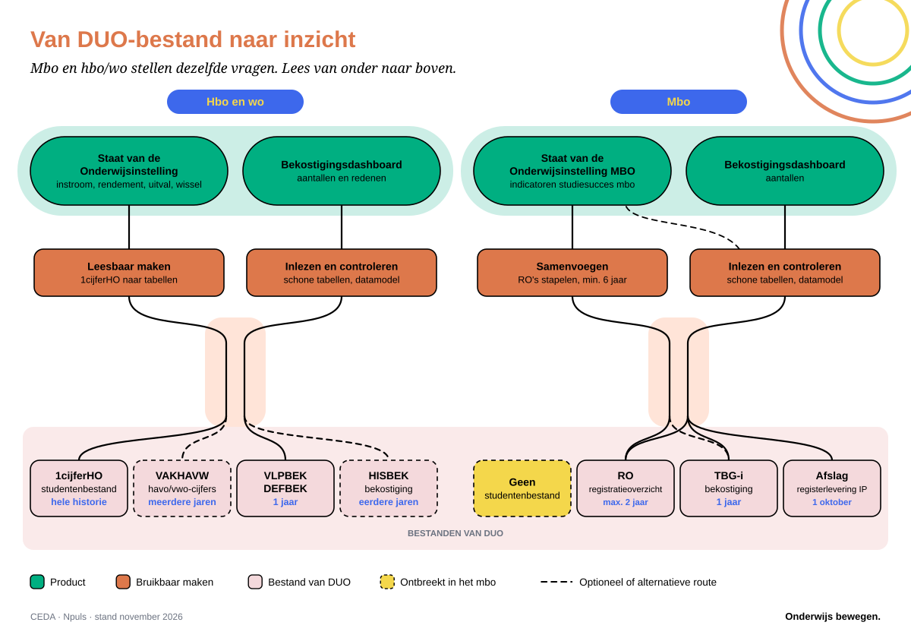

# Sectorale informatievoorziening

Mbo-, hbo- en wo-instellingen krijgen van DUO bestanden over hun studenten en hun bekostiging. Die bestanden zijn gemaakt voor de uitwisseling met DUO, niet voor analyse. Wie wil weten hoe het met de studenten gaat, of waarom een inschrijving niet bekostigd wordt, moet ze eerst leren lezen. Elke instelling doet dat nu apart, met eigen definities, en het mbo heeft andere bestanden dan hbo en wo. Cijfers over studiesucces en bekostiging zijn daardoor moeilijk te vergelijken.

## Wat we doen

CEDA, een team binnen [Npuls](https://npuls.nl), maakt open source tools die deze bestanden inlezen en er cijfers over **studiesucces** en **bekostiging** van maken. De definities liggen vast en zijn gedocumenteerd. Waar de bestanden het toelaten, werken de tools in mbo, hbo en wo op dezelfde manier.

## De informatiestroom

  

Het verschil tussen de sectoren zit in de wortels, de DUO-bestanden. Hbo en wo hebben met 1cijferHO een studentenbestand dat voor studiesucces bedoeld is en de hele historie van de studenten bevat. Het mbo heeft dat niet; daar leiden we studiesucces af uit het registratieoverzicht (RO) en de terugmelding bekostigingsgrondslagen individueel (TBG-i). Een RO beslaat maximaal 2 jaar, dus voor 10 jaar zijn 5 RO's nodig. Een TBG-i gaat over één bekostigingsjaar. Per bestand staat de periode op de pagina [DUO-bestanden](docs/duo-bestanden.md).

## Producten

Namen van bestanden zijn de namen die DUO gebruikt. Elke link gaat naar de plek waar een instelling het bestand ophaalt; waar DUO daar geen openbare pagina voor heeft, naar de uitleg op [DUO-bestanden](docs/duo-bestanden.md).

### Studiesucces

| Product | Voor | DUO-bestanden | Levert |
|---|---|---|---|
| [Staat van de Onderwijsinstelling](https://github.com/cedanl/staat-van-onderwijsinstelling) | hbo en wo | [1cijferHO-bestand](docs/duo-bestanden.md#1cijferho-bestand), eerst omgezet met 1cijferho. [Vakkenbestand (VAKHAVW)](docs/duo-bestanden.md#vakkenbestand-vakhavw), optioneel. | Analysebestand per student. Dashboard met instroom, rendement, uitval en studiewissel. Benchmarkrapport om te delen. |
| [1cijferho](https://github.com/cedanl/1cijferho) | hbo en wo | [1cijferHO-bestand](docs/duo-bestanden.md#1cijferho-bestand), met bestandsbeschrijving en decodeertabellen. [Vakkenbestand (VAKHAVW)](docs/duo-bestanden.md#vakkenbestand-vakhavw), optioneel. | Leesbare tabellen als invoer voor Staat van de Onderwijsinstelling. |
| [wisselstroom](https://github.com/cedanl/wisselstroom) | hbo en wo | [Analysebestand voorlopige bekostiging (VLPBEK)](https://duo.nl/zakelijk/hoger-onderwijs/studentenadministratie/rod-controleren/bekostigingsstatus-studenten.jsp). Of: [Analysebestand definitieve bekostiging (DEFBEK)](https://duo.nl/zakelijk/hoger-onderwijs/studentenadministratie/rod-controleren/bekostigingsstatus-studenten.jsp). | Per inschrijving of een student blijft, wisselt, stapelt, stopt of begint, en naar welke instelling. Stroomdiagram. |
| [Staat van de Onderwijsinstelling MBO](https://github.com/cedanl/staat-van-onderwijsinstelling-mbo) | mbo | [Registratieoverzicht (RO)](https://duo.nl/zakelijk/middelbaar-beroepsonderwijs/studentenadministratie/rod-en-uw-administratie.jsp): één of meer. Eén RO beslaat maximaal 2 jaar; 5 opeenvolgende RO's geven ongeveer 10 jaar. [Terugmelding bekostigingsgrondslagen individueel (TBG-i)](https://duo.nl/zakelijk/middelbaar-beroepsonderwijs/bekostiging-en-subsidies/bekostiging-mbo/terugmelding-bekostigingsgrondslagen-individueel.jsp): optioneel, alleen samen met minstens één RO. | Dashboard met de indicatoren uit de Regeling studiesucces mbo, cohorten en loopbanen. |

### Bekostiging

| Product | Voor | DUO-bestanden | Levert |
|---|---|---|---|
| [ho-bekostiging-bestanden](https://github.com/cedanl/ho-bekostiging-bestanden) | hbo en wo | Eén of meer van: [Analysebestand voorlopige bekostiging (VLPBEK)](https://duo.nl/zakelijk/hoger-onderwijs/studentenadministratie/rod-controleren/bekostigingsstatus-studenten.jsp). [Analysebestand definitieve bekostiging (DEFBEK)](https://duo.nl/zakelijk/hoger-onderwijs/studentenadministratie/rod-controleren/bekostigingsstatus-studenten.jsp). [Historisch bestand definitieve bekostiging (HISBEK)](docs/duo-bestanden.md#historisch-bestand-definitieve-bekostiging-hisbek). | Schone tabellen en datamodel. Dashboard met bekostigingstrechter, redenen van niet-bekostiging, voorlopig tegenover definitief en historie. |
| [mbo-bekostiging-bestanden](https://github.com/cedanl/mbo-bekostiging-bestanden) | mbo | Eén of meer van: [Registratieoverzicht (RO)](https://duo.nl/zakelijk/middelbaar-beroepsonderwijs/studentenadministratie/rod-en-uw-administratie.jsp). [Terugmelding bekostigingsgrondslagen individueel (TBG-i)](https://duo.nl/zakelijk/middelbaar-beroepsonderwijs/bekostiging-en-subsidies/bekostiging-mbo/terugmelding-bekostigingsgrondslagen-individueel.jsp). [Afslag registerlevering IP](docs/duo-bestanden.md#afslag-registerlevering-ip). | Schone tabellen en datamodel. Dashboard met aantallen. |

### Hoe de tools met gegevens omgaan

- De tools draaien op een computer van de instelling. Er gaan geen gegevens naar CEDA of naar een server.
- Ze lezen de bestanden zoals DUO ze levert. Ze rekenen de bekostiging niet opnieuw uit.
- Cijfers zijn indicatief. Het zijn geen officiële cijfers van DUO of de Inspectie.
- Elke tool heeft demodata, zodat je hem kunt bekijken zonder echte gegevens.

Welke DUO-bestanden dit zijn, wat erin staat en waar een instelling ze ophaalt: zie [DUO-bestanden](docs/duo-bestanden.md).

## Waar we heen willen

Drie richtingen, uitgewerkt in [Waar we heen willen](docs/richting.md):

1. Eén open beschrijving van de DUO-bestanden, zodat tools ze automatisch inlezen.
2. Eén overzicht van wie wordt bekostigd en waarom niet, voor mbo en hbo/wo.
3. Studiesucces in het mbo op dezelfde manier volgen als in hbo en wo.

## Presentaties

| Datum | Titel | Over |
|---|---|---|
| 21 september 2026 | [MBO en HO: wat is er mogelijk met de bekostigingsbestanden?](https://github.com/cedanl/clidev-presentaties/blob/main/exports/260921_MBO_HO_bekostigingsbestanden.pdf) (concept) | De bestanden van mbo en hbo/wo naast elkaar, wat tools er nu mee kunnen en welke aanpassingen in vorm mogelijk zijn |
| 1 oktober 2026 | [Een 1CHO voor het mbo?](https://github.com/cedanl/clidev-presentaties/blob/main/exports/261001_mbo_1cho_haalbaarheid.pdf) | Haalbaarheid van een mbo-versie van 1cijferHO: wat werkt, wat ontbreekt en waarom |
| 4 november 2026 | [Staat van de Onderwijsinstelling: impactsessie](https://github.com/cedanl/clidev-presentaties/blob/main/exports/261104_staat1cho_impactsessie/261104_staat1cho_impactsessie.pdf) | Het product voor hbo en wo in de praktijk |
| 5 november 2026 | [Inlezen van TBG-i en registratieoverzicht](https://github.com/cedanl/clidev-presentaties/blob/main/exports/261105_werkgroep2_tbgi_ro.pdf) | Datacoalitie werkgroep 2: demo van mbo-bekostiging-bestanden en wat instellingen met deze bestanden willen |

## Documentatie

Handleidingen en technische documentatie per tool: zie [Documentatie](docs/documentatie.md).

## Contact

Vragen of zin om mee te bouwen?

- E-mail: [ceda@surf.nl](mailto:ceda@surf.nl)
- Community: [CEDA op de Data & AI-community van Npuls](https://community-data-ai.npuls.nl/groups/view/44d20066-53a8-48c2-b4e9-be348e05d273/project-center-for-educational-data-analytics-ceda)
- GitHub: [github.com/cedanl](https://github.com/cedanl)
